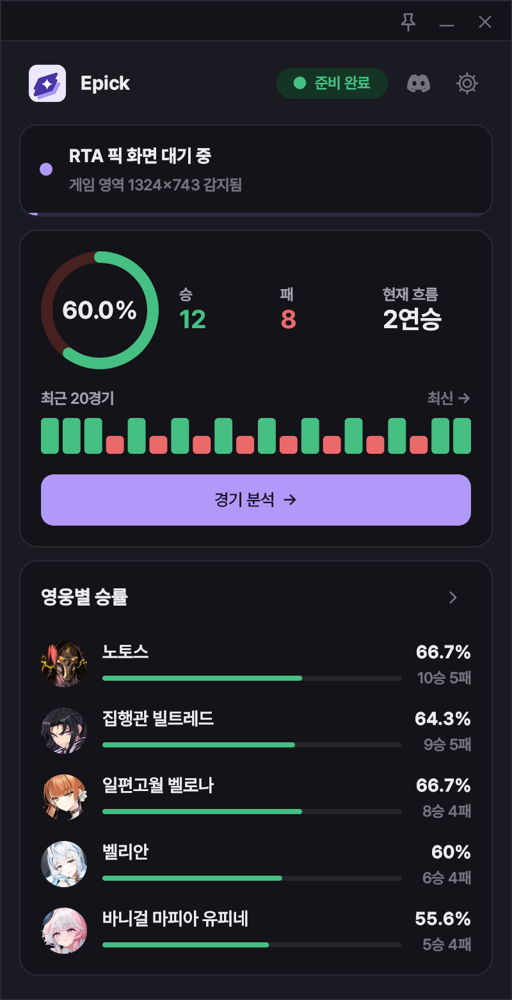
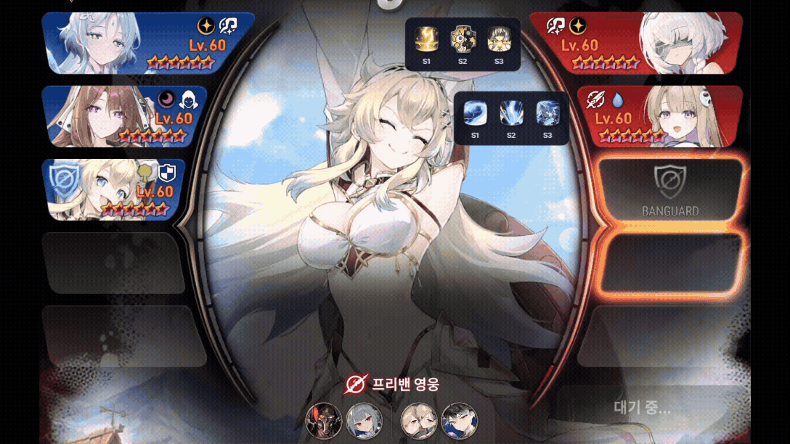
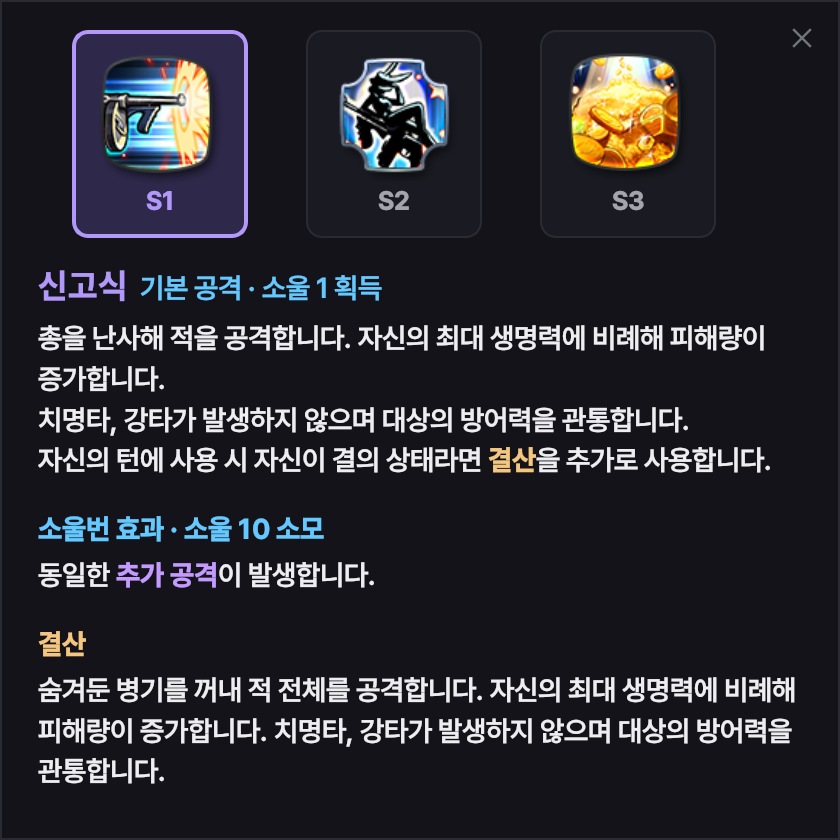
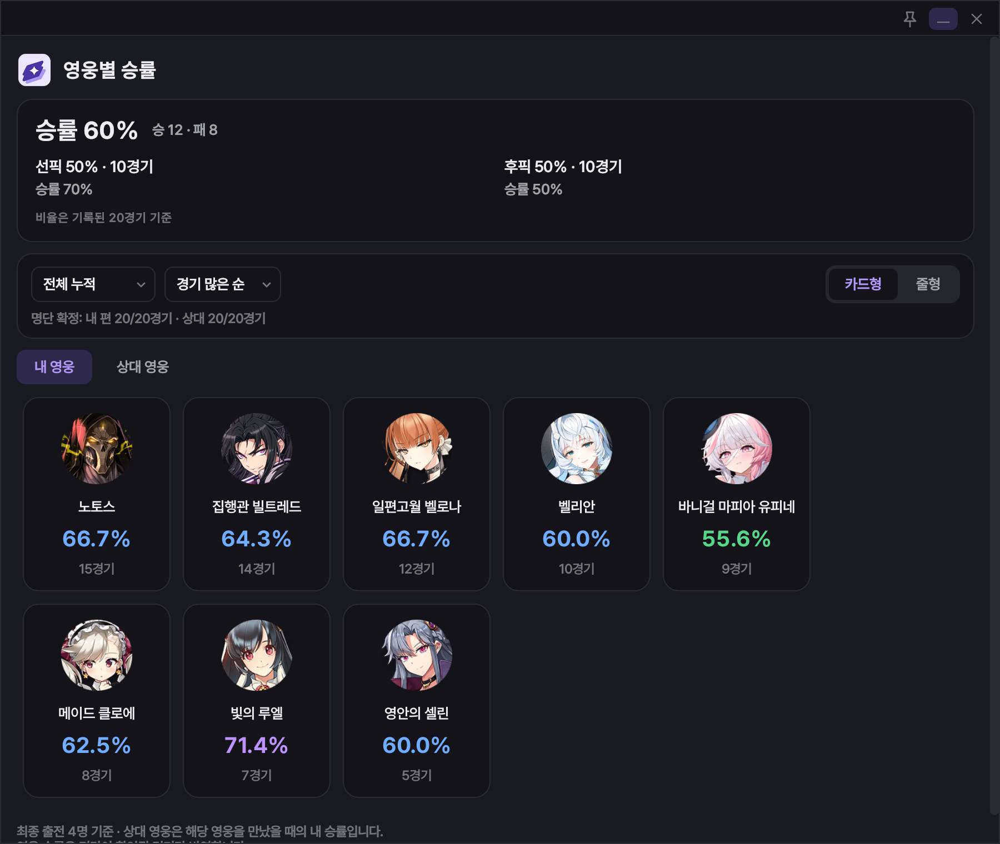
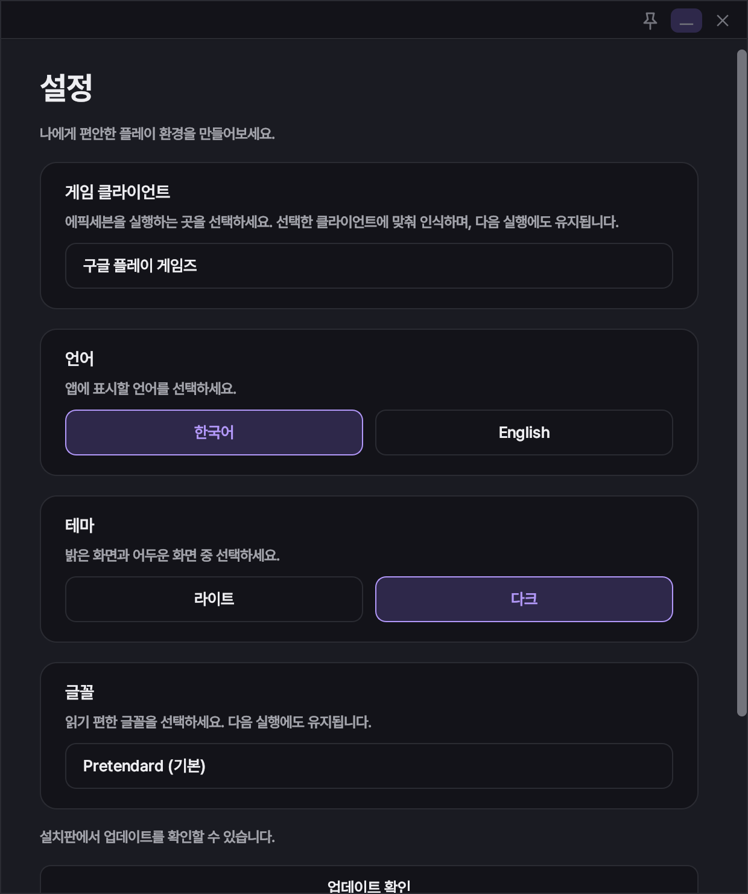

## Installation

1. Download `Epick-{version}-Setup-windows-x64.exe` from the [latest release](https://github.com/monjjj/Epick-Download/releases/latest).
2. Run the installer, then launch Epick.
3. Open the **gear icon → Game client** at the top right and select your setup.
4. Open the **World Arena draft screen** in Epic Seven. Preparing hero data may take a little time on the first launch.
5. Check detected picks and skill information. After a match, review your records on the dashboard and in match analysis.

For a custom game area, follow **Select window → Preview → Adjust margins → Use this area**.

---

  

<h1 align="center">Epick</h1>

  <a href="README.md">한국어</a> · <strong>English</strong>

  <strong>A Windows companion app for Epic Seven World Arena</strong>

  <a href="https://github.com/monjjj/Epick-Download/releases/latest"><strong>Download the latest release</strong></a>
  &nbsp;·&nbsp;
  <a href="https://github.com/monjjj/Epick-Download/releases/download/v0.1.9/Epick-0.1.9-Setup-windows-x64.exe">0.1.9 installer</a>
  &nbsp;·&nbsp;
  <a href="https://discord.gg/hcAaSPapSU">Discord</a>

---

## What you can do with Epick

- **Check hero skills** — Click the skill icons beside an opponent's hero to read its skill descriptions.
- **Review your matches** — See recent results, win rate, first/second pick ratios, and winning or losing streaks.
- **Explore hero statistics** — View matches played and win rates for your heroes and opponents' heroes separately. Choose your last 20, 50, or 100 matches, or all recorded matches.

### If you see “Windows protected your PC” during installation

You may see this message when installing Epick for the first time. Epick is currently distributed without a Windows code signing certificate, which can cause this screen to appear.

If you downloaded the installer from this repository's [official releases](https://github.com/monjjj/Epick-Download/releases/latest), select **More info → Run anyway** to continue installing.

## Screenshots

The dashboard, statistics, settings, and skill description screenshots show the actual **Epick 0.1.7 UI**. Match records and win rates are sample data for demonstration. The draft GIF was recorded and provided by the user from their game.

<table>
  <tr>
    <td valign="top" width="48%">
      <h3>Your recent matches at a glance</h3>
      
See your last 20 matches and the win rates of your most played heroes.

      
    </td>
    <td valign="top" width="52%">
      <h3>Click an icon to check a skill</h3>
      
Skill icons appear once a hero is picked. Click S1, S2, or S3 beside an opponent's hero to view its skill description.

      
      
Live demonstration of skill icons appearing after a hero is picked.

      
      
Skill descriptions are currently provided in Korean. The app interface supports Korean and English.

    </td>
  </tr>
</table>

### Hero statistics and match analysis

Change the period and sorting, or switch between card and row views. You can also see first/second pick ratios and their win rates.

Hero statistics use the **four heroes that participated after the final ban**. An **opponent hero's win rate is your win rate when facing that hero**.

### Client and appearance settings

Select the client you use to play. Epick remembers your client and appearance settings the next time it starts.

## System requirements

**Windows 10 version 2004 or later / Windows 11 · 64-bit.** The installer includes the components needed to run the app.

| Game client setting | Use this for |
| --- | --- |
| PC (STOVE & Steam) | Epic Seven launched through STOVE or Steam |
| Google Play Games | Epic Seven running in Google Play Games |
| MuMuPlayer | Epic Seven running in MuMuPlayer |
| Custom game area | A game window and capture area you select manually |

Keep the game window unobstructed when using MuMuPlayer or a custom game area. Live draft and skill display checks for these modes are still ongoing across different setups.

## Updates and saved records

- The current release is **0.1.9**. Epick checks for updates on launch and asks before opening the dashboard. Choose No to open the current version. It also checks for new releases every five minutes while running.
- **If you use 0.1.6, download and install the latest installer directly.** Versions 0.1.7 and later check this repository for updates.
- New installations use `Epick` as the default installation folder. Updating or uninstalling the app does not automatically delete your match records or settings.
- The release's `.exe.sha256` file is for file verification, and `update-epick.json` is used by the app updater. To install Epick, download the **`Setup-windows-x64.exe` file**.

## Questions and feedback

If recognition is not working or you have a suggestion, contact us on [Discord](https://discord.gg/hcAaSPapSU). Include your game client and the screen where the issue occurred. Before sharing screenshots, check for nicknames or other information you do not want to make public.

---

Epick is an unofficial community companion for Epic Seven. This repository provides installers and usage instructions.
