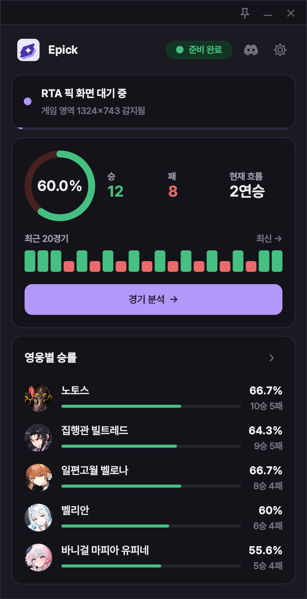
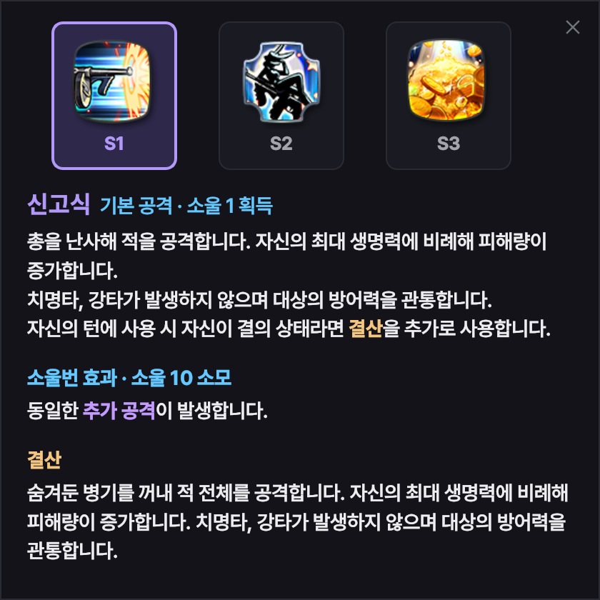
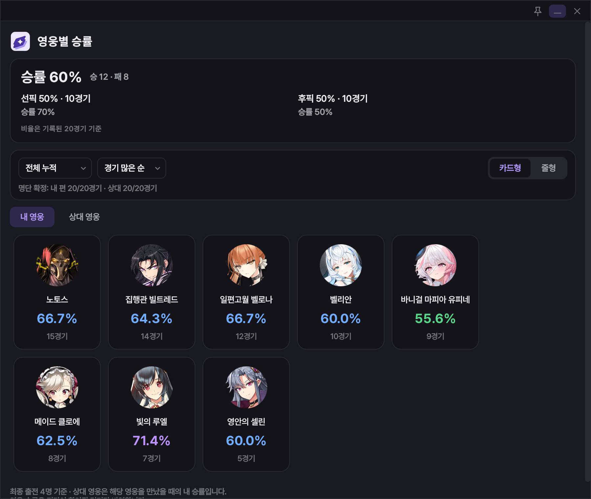
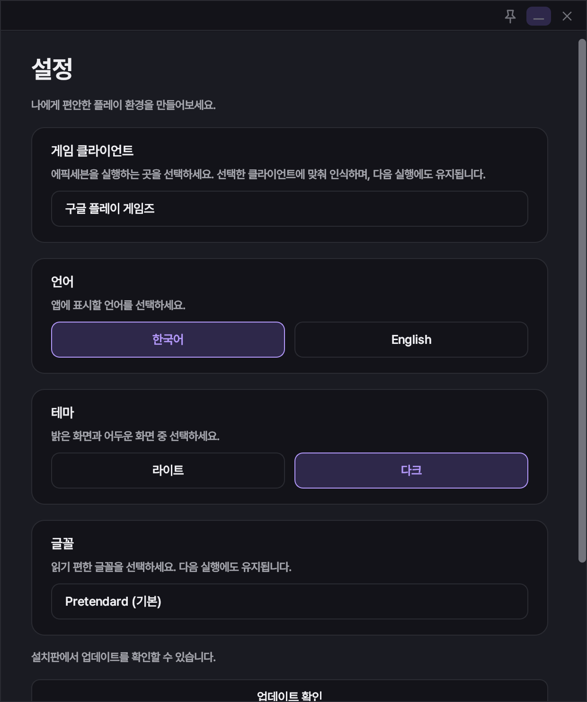

  

<h1 align="center">Epick</h1>

  <strong>에픽세븐 월드 아레나를 위한 Windows 보조 앱</strong> 

  <a href="https://github.com/monjjj/Epick-Download/releases/latest"><strong>최신 버전 다운로드</strong></a>
  &nbsp;·&nbsp;
  <a href="https://github.com/monjjj/Epick-Download/releases/download/v0.1.8/Epick-0.1.8-Setup-windows-x64.exe">0.1.8 설치 파일</a>
  &nbsp;·&nbsp;
  <a href="https://discord.gg/hcAaSPapSU">Discord</a>

---

## Epick으로 할 수 있는 것

- **영웅 스킬 확인** — 상대 영웅의 스킬 아이콘을 누르면 설명을 볼 수 있습니다.
- **경기 기록 돌아보기** — 최근 경기의 승패, 승률, 선·후픽 비율, 연승·연패 흐름을 확인합니다.
- **영웅별 통계 보기** — 내 영웅과 상대 영웅을 나누어 경기 수와 승률을 살펴봅니다. 최근20·50·100경기와 전체 누적을 선택할 수 있습니다.

### 설치할 때 ‘Windows의 PC 보호’ 창이 나타난다면

처음 설치할 때 **‘Windows의 PC 보호’** 안내가 나타날 수 있습니다. 현재 Epick은 별도의 Windows 코드 서명 인증서 없이 배포하고 있어 표시될 수 있는 화면입니다.

이 저장소의 [공식 릴리즈](https://github.com/monjjj/Epick-Download/releases/latest)에서 설치 파일을 받으셨다면, **‘추가 정보’ → ‘실행’**을 눌러 설치를 진행할 수 있습니다.

## 화면 미리보기

아래는 **Epick 0.1.7의 실제 앱 UI를 캡처한 화면**입니다. 전적과 승률은 기능 소개를 위한 예시 데이터입니다.

<table>
  <tr>
    <td valign="top" width="48%">
      <h3>한눈에 보는 최근 전적</h3>
      
최근20경기와 자주 사용한 영웅의 승률을 확인합니다.

      
    </td>
    <td valign="top" width="52%">
      <h3>아이콘을 눌러 스킬 확인</h3>
      
S1·S2·S3을 선택해 스킬 설명을 읽습니다.

      
      
예시 영웅: 바니걸 마피아 유피네

    </td>
  </tr>
</table>

### 영웅별 통계와 경기 분석

기간과 정렬 방식을 바꾸고 카드형·줄형 보기로 비교할 수 있습니다. 선픽·후픽 비율과 각 승률도 함께 확인합니다.

영웅별 통계는 **최종 출전한4명**을 기준으로 합니다. **상대 영웅의 승률은 그 영웅을 만났을 때의 내 승률**입니다.

### 클라이언트와 화면 설정

설정에서 플레이 중인 클라이언트를 선택하세요. 선택한 클라이언트와 화면 설정은 다음 실행에도 유지됩니다.

## 처음 사용하기

1. [최신 릴리즈](https://github.com/monjjj/Epick-Download/releases/latest)에서 `Epick-버전-Setup-windows-x64.exe`를 내려받습니다.
2. 설치 파일을 실행해 Epick을 설치하고 실행합니다.
3. 오른쪽 위 **톱니바퀴 → 게임 클라이언트**에서 자신의 실행 환경을 선택합니다.
4. 에픽세븐에서 **월드 아레나 픽 화면**으로 이동합니다. 처음 실행할 때는 영웅 자료 준비에 잠시 시간이 걸립니다.
5. 픽 인식과 스킬 정보를 확인하고, 경기 후 대시보드와 경기 분석에서 기록을 살펴봅니다.

커스텀 영역 선택은 **창 선택 → 화면 미리보기 → 여백 조정 → 이 영역 사용** 순서로 설정합니다.

## 실행 환경

**Windows10 버전2004 이상 / Windows11 · 64비트**에서 사용할 수 있습니다. 설치 파일에 실행에 필요한 구성 요소가 포함되어 있습니다.

| 게임 클라이언트 설정 | 사용 환경 |
| --- | --- |
| PC(STOVE & Steam) | STOVE 또는 Steam으로 실행한 에픽세븐 |
| 구글 플레이 게임즈 | Google Play Games로 실행한 에픽세븐 |
| 무무플레이어 | 무무에서 실행한 에픽세븐 |
| 커스텀 영역 선택 | 사용자가 직접 게임 창과 인식할 영역을 지정 |

무무와 커스텀 영역 모드에서는 게임 화면이 다른 창에 가려지지 않도록 해주세요. 두 모드의 실제 픽·스킬 표시는 환경별 추가 확인을 진행하고 있습니다.

## 업데이트와 기록

- 현재 배포 버전은 **0.1.8**입니다. 설정에서 STOVE와 Steam을 같은 PC 클라이언트 항목으로 선택할 수 있으며, 디스코드 문의 주소를 갱신했습니다.
- **기존0.1.6 사용자는 최신 설치 파일을 직접 받아 설치해주세요.** 0.1.7부터 앱의 업데이트 확인은 이 저장소를 사용합니다.
- 새 설치 화면의 기본 폴더는 `Epick`입니다. 기존 전적과 설정은 업데이트하거나 앱을 제거해도 자동으로 지우지 않습니다.
- 릴리즈의 `.exe.sha256`은 파일 검증용, `update-epick.json`은 앱 업데이트용입니다. 설치할 때는 **`Setup-windows-x64.exe` 파일**을 받으세요.

## 문의와 피드백

인식이 잘되지 않거나 개선 의견이 있으면 [Discord](https://discord.gg/hcAaSPapSU)로 알려주세요. 사용한 클라이언트와 문제가 발생한 화면을 함께 알려주시면 확인에 도움이 됩니다. 사진을 공유할 때는 닉네임 등 공개하고 싶지 않은 정보가 포함됐는지 확인해주세요.

---

Epick은 에픽세븐을 위한 비공식 커뮤니티 보조 도구입니다. 이 저장소는 설치 파일과 사용 안내를 제공합니다.
